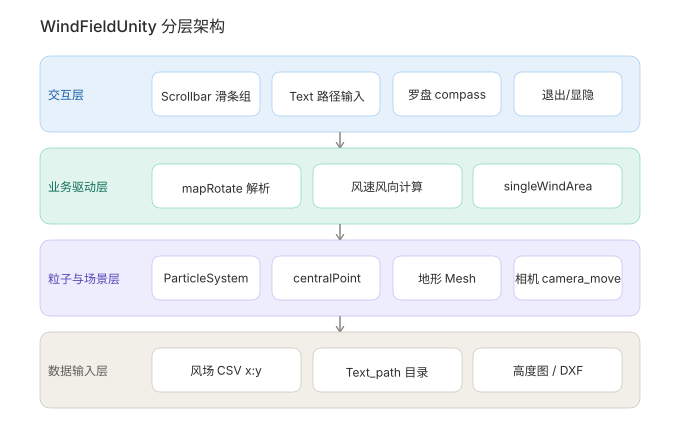
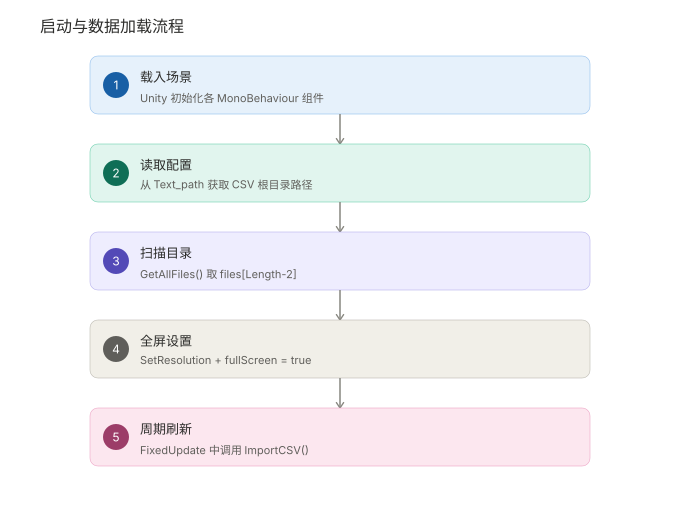
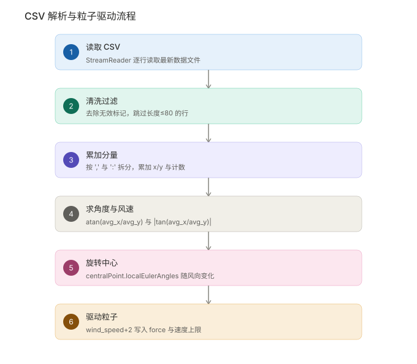
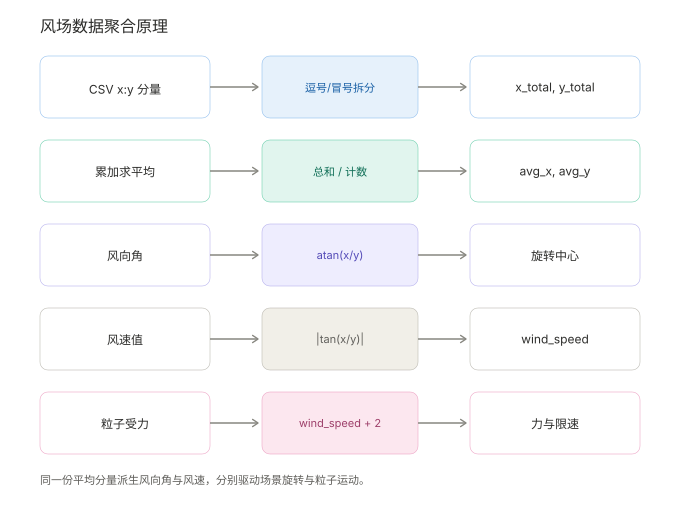

# 系统架构与关键流程

## 1. 分层架构

脚本按职责可分为数据输入层、业务驱动层、粒子/场景层与交互层。



| 层次 | 组成 | 职责 |
|------|------|------|
| 数据输入层 | 风场 CSV、`Text_path`、`heightMap`、`singleWindArea.csvFilePath` | 提供风向风速矢量分量、目录路径与地形高度 |
| 业务驱动层 | `mapRotate`、`singleWindArea` | 扫描最新文件、解析 CSV、求平均分量、计算风向角与风速 |
| 粒子/场景层 | `change_wind`、`force`、`particleSys`、`ParticleMove`、`centralPoint`、相机与罗盘 | 把风速映射为受力/限速，旋转风场中心，漫游与指向 |
| 交互层 | `scrollbar_*`、`winderDirSiderCtr`、`showArror`/`hideArror`、`closeWindow` | 旋转角/风速/高度调节、箭头层显隐与退出 |

**核心数据流**：CSV 矢量分量 → `ImportCSV()` 累加求平均 → `atan` 得到旋转角、`|tan|` 得到风速 →
`centralPoint` 旋转 + 粒子受力/限速 → 风场可视化。

## 2. 关键流程一：启动与数据加载



1. Unity 载入场景，各 `MonoBehaviour.Start()` 执行；
2. `mapRotate.Start()` 从 `Text_path` 读取根目录，设置最高分辨率与全屏；
3. `GetAllFiles()` 在目录中取 `files[files.Length - 2]` 作为数据文件；
4. 进入 `FixedUpdate()`，周期重新取路径并调用 `ImportCSV()`；
5. 解析结果写入 `wind_speed` 与 `centralPoint.localEulerAngles`。

## 3. 关键流程二：CSV 解析到粒子驱动



1. `StreamReader` 逐行读取，替换 `-999.0:-999.0`，跳过长度 ≤ 80 的行；
2. 按 `,` 与 `:` 拆分，累加 `x_total` / `y_total` / `total_count`；
3. 求 `avg_x` / `avg_y`，得到 `rotate_angle = atan(avg_x/avg_y)` 与 `wind_speed = |tan(avg_x/avg_y)|`；
4. `centralPoint.localEulerAngles = (0, rotate_angle, 0)`；
5. `change_wind.Update()` 把 `wind_speed + 2f` 写入 `forceOverLifetime.z` 与 `limitVelocityOverLifetime.limit`；
6. 粒子系统按新受力/限速更新，形成随数据变化的风场。

## 4. 数据聚合原理



每个 CSV 字段是一个 `x:y` 矢量分量，代表一个观测点的风向/风速信息。
`ImportCSV()` 对所有有效观测求平均分量 `avg_x` / `avg_y`：
`atan(avg_x/avg_y)` 给出整体风向（用于旋转风场中心），
`|tan(avg_x/avg_y)|` 给出整体风速（用于驱动粒子）。
两种方式共享同一份累加结果，保证方向显示与粒子速度一致。

## 5. 时序关系

```text
Start
  └─ 读取 Text_path / 设置全屏
FixedUpdate (周期)
  └─ GetAllFiles ─> ImportCSV ─> avg_x, avg_y
                                   ├─> atan     ─> centralPoint.localEulerAngles
                                   └─> |tan|    ─> mapRotate.wind_speed
                                                      └─> change_wind.Update ─> 粒子 force/limit
Update (每帧)
  ├─ particleSys   : 逐粒子位移
  ├─ force         : 受力曲线
  ├─ camera_move   : 相机漫游
  ├─ compass       : 罗盘指向
  └─ scrollbar_*   : UI 调参（见 06-notes 重复注册说明）
```

- `ImportCSV()` 在 `FixedUpdate()` 中运行，与帧率解耦；
- 粒子位移、相机、罗盘与 UI 在 `Update()` 中逐帧运行；
- `singleWindArea` 走独立 CSV 路径，结果只写入 `global_wind_dir_x/y`，未直接接入主风场粒子驱动。
